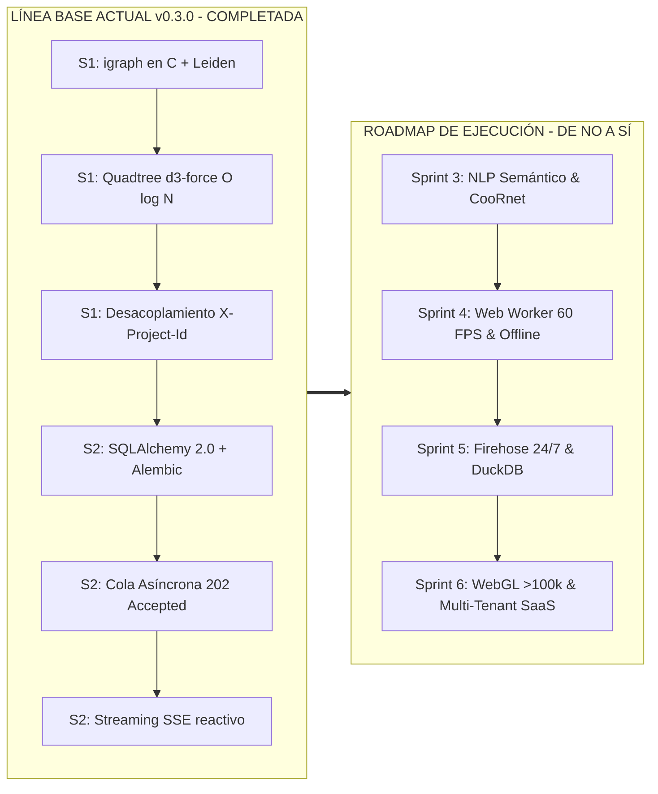

# Plan Maestro de Trabajo e Ingeniería — TRAMA v0.3.0 ➔ v1.0.0 Enterprise

> **Documento:** Plan de Trabajo, Sprints y Hoja de Ruta Técnica  
> **Sistema:** TRAMA (Inteligencia de Redes Sociales, Análisis Forense CIB y War Room Electoral)  
> **Línea Base Actual:** v0.3.0 (Sprints 1 y 2 completados al 100%, 31 tests pasando)  
> **Meta Final:** v1.0.0 Enterprise (WebGL >100k nodos, Firehose 24/7 en tiempo real, NLP semántico y SaaS Multi-Tenant)  
> **Duración Total:** 12 Semanas (6 Sprints de 2 semanas)

---

## 1. Estado de Avance y Línea Base Verificada (v0.3.0)



### Funcionalidades Verificadas en el Código
* [x] **Motor de Grafos en C:** Algoritmo Leiden de particionamiento comunitario ($<50\text{ ms}$ en grafos de 10k nodos) y PageRank normalizado (0-100) en `python-igraph`.
* [x] **Aislamiento Concurrente:** Desacoplamiento total del estado global en memoria en [`backend/app/main.py`](file:///home/djfa/Dev/projects/SDL/trama/backend/app/main.py) con inyección de dependencias `Depends(get_current_project)` y soporte para cabecera `X-Project-Id`.
* [x] **Indexación Espacial Quadtree:** Detección de nodos bajo cursor en $O(\log N)$ ($<0.01\text{ ms}$) en [`frontend/components/GraphCanvas.jsx`](file:///home/djfa/Dev/projects/SDL/trama/frontend/components/GraphCanvas.jsx).
* [x] **Persistencia Relacional Normalizada:** SQLAlchemy 2.0 y migraciones versionadas con Alembic (`alembic upgrade head`) en SQLite y PostgreSQL.
* [x] **Ingesta Asíncrona con Streaming SSE:** Endpoint desacoplado con respuesta `202 Accepted`, barra de progreso granular en tiempo real (`TaskProgressModal.jsx`) y sanitización de inyección de fórmulas CSV (CWE-1236).
* [x] **Módulo Político (War Room):** Diagnóstico de *Echo Chamber Index* (ECI), buscador de aliados puente y rutas de expansión hacia indecisos en [`backend/app/political.py`](file:///home/djfa/Dev/projects/SDL/trama/backend/app/political.py).
* [x] **NLP Semántico y Detección de Parafraseo (Sprint 3 / Bloque A):** Similitud semántica con `paraphrase-multilingual-MiniLM-L12-v2` (`sentence-transformers`), lazy loading y fallback determinista (MinHash + TF-IDF n-grams), combinado con LSH para aislar copypasta (>0.85, ventana $\Delta t < 15\text{ min}$) en [`backend/app/nlp.py`](file:///home/djfa/Dev/projects/SDL/trama/backend/app/nlp.py).
* [x] **CooRnet con Prueba de Monte Carlo (Sprint 3 / Bloque A):** Prueba estadística de permutación Monte Carlo global ($p$-valor empírico por arista y por componente conexa) con semilla determinista configurable en [`backend/app/cib.py`](file:///home/djfa/Dev/projects/SDL/trama/backend/app/cib.py).
* [x] **Capa Visual CooRnet y Clústeres Textuales (Sprint 3 / Bloque A):** Visualizador de clústeres en [`frontend/components/panels/DossierPanel.jsx`](file:///home/djfa/Dev/projects/SDL/trama/frontend/components/panels/DossierPanel.jsx) y capa visual secundaria neón animada con halos de sincronización en [`frontend/components/GraphCanvas.jsx`](file:///home/djfa/Dev/projects/SDL/trama/frontend/components/GraphCanvas.jsx) activable desde [`TopBar.jsx`](file:///home/djfa/Dev/projects/SDL/trama/frontend/components/TopBar.jsx).
* [x] **Calidad de Código y Cobertura:** 48 tests unitarios y de integración pasando al 100% (`pytest backend/tests` con 8 nuevos tests del Bloque A: controles positivos de bots y controles negativos de tráfico orgánico). Build estático de Next.js 14 sin errores.

---

## 2. Matriz de Brechas Técnicas: "Cómo convertimos cada NO en SÍ"

| Límite Actual ("NO") | Meta Enterprise ("SÍ") | Sprint Asignado | Estrategia de Solución de Ingeniería |
|---|---|:---:|---|
| **Detección sólo de red (sin análisis de texto)** | Detección semántica de mensajes idénticos o parafraseados (copypasta) | **Sprint 3** (Semanas 5-6) | Modelo multilingüe local `MiniLM-L12-v2` + Hashing sensible a la localidad (MinHash / LSH) para textos con similitud $>85\%$. |
| **CIB sólo estructural** | Redes de Co-compartición coordinada (*Co-sharing / CooRnet*) | **Sprint 3** (Semanas 5-6) | Grafo secundario de perfiles que amplifican los mismos enlaces/posts en ventanas temporales estrechas ($\Delta t \le 45\text{ s}$). |
| **Cálculo físico congela el hilo principal (>5k nodos)** | 60 FPS estables y fluidos durante la interacción | **Sprint 4** (Semanas 7-8) | Trasladar la simulación de fuerzas a un **Web Worker** dedicado comunicando buffers tipados `Float32Array`. |
| **Dependencia del servidor local** | Funcionamiento 100% autónomo sin backend (modo avión) | **Sprint 4** (Semanas 7-8) | Motor `@graphology` en navegador + parseo local con `PapaParse` y persistencia en `IndexedDB` (Dexie.js). |
| **Ingesta manual exclusiva por archivo CSV** | Monitoreo continuo 24/7 en tiempo real | **Sprint 5** (Semanas 9-10) | Cliente WebSocket para consumo en streaming del Jetstream de Bluesky (AT Protocol) y conector API v2 de X. |
| **Límite de memoria para eventos masivos** | Consultas analíticas en sub-segundos sobre millones de posts | **Sprint 5** (Semanas 9-10) | Motor columnar embebido **DuckDB** sobre particiones **Apache Parquet**. |
| **Límite gráfico de 5.000 nodos en Canvas 2D** | Capacidad visual para **>100.000 nodos y 300.000 aristas** | **Sprint 6** (Semanas 11-12) | Motor de renderizado **WebGL acelerado por GPU (Sigma.js v3)** con *Instanced Drawing* y LOD semántico. |
| **Aplicación monousuario sin control de acceso** | Plataforma SaaS Multi-Tenant corporativa y privada | **Sprint 6** (Semanas 11-12) | Autenticación JWT, RBAC (*Admin, Lead Investigator, Analyst*) y *Row-Level Security* (RLS) en PostgreSQL. |

---

## 3. Cronograma Maestro y Desglose por Sprints

```
┌────────────────────────────────────────────────────────────────────────┐
│ CRONOGRAMA DE EJECUCIÓN (12 SEMANAS)                                   │
├──────────┬──────────────────────────────────────────┬──────────────────┤
│ Fase     │ Objetivo Principal                       │ Estado           │
├──────────┼──────────────────────────────────────────┼──────────────────┤
│ Sprint 1 │ Rendimiento C (igraph), Quadtree y San.  │ ✅ COMPLETADO    │
│ Sprint 2 │ Streaming SSE, Asincronía y SQLAlchemy   │ ✅ COMPLETADO    │
│ Sprint 3 │ Inteligencia Forense NLP, LSH y CooRnet  │ ✅ COMPLETADO    │
├──────────┼──────────────────────────────────────────┼──────────────────┤
│ Sprint 4 │ Física en Web Worker, Offline y PDF      │ 🟡 SIGUIENTE     │
│ Sprint 5 │ Firehose Streaming 24/7 y DuckDB Columnar│ ⚪ PLANIFICADO   │
│ Sprint 6 │ Motor WebGL Masivo (>100k) & SaaS RBAC   │ ⚪ PLANIFICADO   │
└──────────┴──────────────────────────────────────────┴──────────────────┘
```

---

### Sprint 3: Inteligencia Forense Avanzada (NLP, Co-sharing y Polarización)
**Objetivo:** Transformar TRAMA de un analizador topológico a un motor forense de última generación capaz de detectar propaganda coordinada y desinformación semántica.

* **Duración:** Semanas 5 y 6
* **Paquetes Requeridos:** `sentence-transformers`, `datasketch`, `scikit-learn`

#### Tareas del Sprint
1. **[Backend / NLP] Pipeline de Embeddings Semánticos y MinHash/LSH:**
   - Crear [`backend/app/nlp.py`](file:///home/djfa/Dev/projects/SDL/trama/backend/app/nlp.py).
   - Integrar modelo local ligero (`paraphrase-multilingual-MiniLM-L12-v2`) con ejecución cuantizada en CPU.
   - Indexación MinHash y Locality Sensitive Hashing (LSH) para detectar clústeres de publicaciones idénticas o parafraseadas con umbral Jaccard $\ge 0.85$ en ventanas $\Delta t < 15\text{ min}$.
2. **[Backend / Forense] Algoritmo CooRnet (Redes de Co-compartición Coordinada):**
   - Construir grafo bipartito y proyección de co-compartición de URLs, hashtags o mensajes compartidos en ventanas hiperestrechas ($\Delta t \le 45\text{ s}$).
   - Prueba estadística de permutación de Monte Carlo para filtrar la amplificación orgánica y aislar la red de bots coordinada.
3. **[Backend / Métricas] Cuantificación de Polarización RWC (Random Walk Controversy):**
   - Implementar el algoritmo de controversia por paseos aleatorios (Garimella et al.) en [`backend/app/political.py`](file:///home/djfa/Dev/projects/SDL/trama/backend/app/political.py) para cuantificar la rigidez de las cámaras de eco enfrentadas.
4. **[Frontend] Panel Forense Renovado:**
   - Incorporar visualizador de clústeres textuales en [`DossierPanel.jsx`](file:///home/djfa/Dev/projects/SDL/trama/frontend/components/panels/DossierPanel.jsx).
   - Mostrar métrica de polarización RWC y conductancia en [`WarRoomPanel.jsx`](file:///home/djfa/Dev/projects/SDL/trama/frontend/components/panels/WarRoomPanel.jsx).

* **Criterio de Aceptación (DoD) — ✅ CUMPLIDO AL 100%:**
  - [x] Detección precisa de variaciones de textos copypasta con porcentaje de similitud y marcas temporales.
  - [x] Generación del grafo de co-compartición accesible como capa visual secundaria.
  - [x] Cobertura de pruebas automatizadas con datasets sintéticos de propaganda coordinada (8 nuevos tests pasando, 48 en total).

---

### Sprint 4: Física en Web Worker, Modo Offline Total y Reportes PDF
**Objetivo:** Garantizar autonomía total al analista en campo (modo avión) y eliminar caídas de frames en la interfaz gráfica.

* **Duración:** Semanas 7 y 8
* **Paquetes Requeridos:** `graphology`, `graphology-layout-forceatlas2`, `dexie`, `weasyprint` / `playwright`

#### Tareas del Sprint
1. **[Frontend / Rendimiento] Simulación Física en Web Worker Dedicado:**
   - Trasladar el cómputo de fuerzas `d3-force` / `ForceAtlas2` fuera del hilo principal de React a un Worker Web dedicado (`graph.worker.js`).
   - Transferencia de coordenadas y velocidades mediante buffers tipados `Float32Array` compartidos, garantizando 60 FPS estables sin importar el tamaño del grafo.
2. **[Frontend / Offline] Motor en Cliente con Graphology e IndexedDB:**
   - Incorporar `@graphology` en el navegador para calcular modularidad Louvain y PageRank en cliente cuando no haya backend disponible.
   - Parser local de CSV con `PapaParse` en segundo plano.
   - Almacenamiento local de investigaciones en `IndexedDB` (vía Dexie.js).
3. **[Backend / Exportación] Generador Headless de Informes Ejecutivos en PDF:**
   - Servicio de renderizado PDF con WeasyPrint en [`backend/app/reports.py`](file:///home/djfa/Dev/projects/SDL/trama/backend/app/reports.py).
   - Generación de informe imprimible a 300 DPI: portada institucional, resumen macro, tabla de líderes, fichas periciales CIB y captura vectorial del grafo.
4. **[UX / Filtros] Sliders de Umbral Multicriterio con Histogramas:**
   - Controles interactivos en tiempo real para filtrar nodos por percentil de influencia, índice de sospecha CIB (0-100) y comunidades activas.

* **Criterio de Aceptación (DoD):**
  - La aplicación permite arrastrar un CSV y analizarlo completamente sin conexión a internet.
  - Paneo y zoom fluidos a 60 FPS continuos durante la estabilización de la simulación.
  - Descarga de PDF profesional en un clic con maquetación de imprenta.

---

### Sprint 5: Ingesta en Streaming 24/7 y Motor Analítico Columnar
**Objetivo:** Eliminar la dependencia de archivos CSV manuales y habilitar captura continua de conversaciones desde redes sociales modernas.

* **Duración:** Semanas 9 y 10
* **Paquetes Requeridos:** `duckdb`, `pyarrow`, `websockets`, `aiohttp`

#### Tareas del Sprint
1. **[Backend / Conectores] Modelo Canónico de Eventos de Red (`InteractionEvent`):**
   - Estandarización de esquema de evento temporal: `actor`, `target`, `timestamp`, `action_type` (retweet, quote, reply, forward), `platform`, `content`.
2. **[Backend / Streaming] Conector Bluesky AT Protocol (Jetstream Firehose):**
   - Cliente WebSocket asíncrono para suscribirse al Jetstream público de Bluesky en tiempo real con filtrado dinámico por hashtags y términos clave.
3. **[Backend / Ingesta] Conectores de Telegram y X/Twitter:**
   - Parser de exportaciones JSON de canales y grupos de Telegram para grafos de reenvíos (*forwards*).
   - Ingestor de eventos JSON de la API v2 de X con control de cuotas (*rate limiting*).
4. **[Backend / Big Data] Motor Columnar DuckDB + Apache Parquet:**
   - Almacenamiento de millones de eventos en particiones Parquet por fecha y proyecto en disco.
   - Consultas analíticas instantáneas (agregaciones por minuto, ventanas móviles de co-ocurrencia) ejecutadas en DuckDB en $<300\text{ ms}$ sin desbordar la memoria RAM.

* **Criterio de Aceptación (DoD):**
  - Conexión funcional en vivo al firehose de Bluesky con construcción dinámica del grafo en tiempo real.
  - Consultas sobre 2 millones de eventos temporales responden en menos de 300 ms mediante DuckDB.

---

### Sprint 6: Motor WebGL Masivo (>100k nodos), RBAC Multi-Tenant y Certificación
**Objetivo:** Escalar la visualización a más de 100.000 nodos y convertir TRAMA en una plataforma SaaS multi-inquilino lista para despliegues gubernamentales y corporativos.

* **Duración:** Semanas 11 y 12
* **Paquetes Requeridos:** `sigma`, `graphology-library`, `python-jose`, `passlib`, `playwright`

#### Tareas del Sprint
1. **[Frontend / Gráficos Masivos] Motor de Renderizado WebGL con Sigma.js v3:**
   - Renderizado acelerado por GPU mediante *Instanced Drawing* con capacidad para manipular 100.000 nodos y 300.000 aristas a 60 FPS estables.
   - Nivel de detalle dinámico (LOD): agregación semántica de nodos en conglomerados visuales al alejar el zoom.
2. **[Seguridad / Multi-Tenant] Autenticación JWT y Control de Acceso RBAC:**
   - Soporte para organizaciones independientes y proyectos privados.
   - Roles granulares: `Admin`, `Lead Investigator`, `Analyst`, `Viewer`.
   - Aislamiento estricto de investigaciones mediante *Row-Level Security* (RLS) en PostgreSQL.
   - Rotación segura de refresh tokens en cookies `HttpOnly` y soporte 2FA (TOTP).
3. **[DevOps & QA] Suite de Pruebas E2E y Pipeline de Integración Continua:**
   - Pruebas automatizadas de extremo a extremo con Playwright cubriendo el flujo completo: creación de proyecto -> streaming -> análisis CIB -> exportación PDF.
   - Pipeline de GitHub Actions con linters (`ruff`, `eslint`), auditorías de seguridad (`trivy`, `pip-audit`) y despliegue continuo en contenedores Docker.

* **Criterio de Aceptación (DoD):**
  - Carga y manipulación fluida de un grafo de 100.000 nodos en un navegador convencional sin lag perceptible.
  - Aislamiento estricto de investigaciones entre organizaciones verificado mediante tests de penetración multi-tenant.
  - Pipeline de CI/CD 100% verde con despliegue automatizado.

---

## 4. Matriz de Seguimiento y Métricas de Éxito

```
┌───────────────────────────────────────┬───────────────────┬───────────────────┬───────────────────┐
│ DIMENSIÓN                             │ LÍNEA BASE v0.3.0 │ META SPRINT 4     │ META FINAL v1.0   │
├───────────────────────────────────────┼───────────────────┼───────────────────┼───────────────────┤
│ Escala Máxima Soportada               │ ~5.000 nodos      │ ~25.000 nodos     │ >100.000 nodos    │
│ Tasa de Refresco Visual (FPS)         │ 60 FPS (<2k)      │ 60 FPS (<15k)     │ 60 FPS constantes │
│ Tiempo de Detección de Nodo (Hover)   │ <0.01 ms (Quad.)  │ <0.01 ms (Quad.)  │ <0.01 ms (GPU)    │
│ Modo Offline                          │ Solo demo JSON    │ 100% Autónomo     │ 100% Autónomo     │
│ Ingesta de Datos                      │ CSV manual        │ CSV + Worker      │ Streaming 24/7    │
│ Detección Forense CIB                 │ 4 reglas topolog. │ Topología + NLP   │ CooRnet + LSH     │
│ Arquitectura de Usuarios              │ Monousuario local │ Monousuario local │ Multi-Tenant RBAC │
└───────────────────────────────────────┴───────────────────┴───────────────────┴───────────────────┘
```

---

## 5. Próxima Acción Inmediata: Arranque del Sprint 3

Para comenzar la ejecución inmediata del **Sprint 3 (Días 1 a 14)**:
1. Instalar dependencias de NLP en el backend: `pip install datasketch sentence-transformers scikit-learn`.
2. Crear el módulo [`backend/app/nlp.py`](file:///home/djfa/Dev/projects/SDL/trama/backend/app/nlp.py) con funciones para MinHash, LSH y similitud semántica.
3. Crear el generador de grafos de co-compartición CooRnet en [`backend/app/cib.py`](file:///home/djfa/Dev/projects/SDL/trama/backend/app/cib.py).
4. Crear la suite de pruebas automatizadas en [`backend/tests/test_nlp.py`](file:///home/djfa/Dev/projects/SDL/trama/backend/tests/test_nlp.py).
